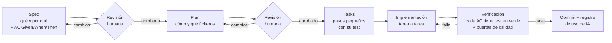

# Metodología de trabajo con IA

Senda se desarrolla con agentes de IA siguiendo **Spec-Driven Development (SDD)**: cada funcionalidad se especifica antes de escribir código, con revisiones humanas en los puntos donde se decide, y puertas de calidad automáticas que verifican lo que el agente produce. El flujo vive en ficheros markdown del repo, así que funciona igual con cualquier agente (HAR-03).

Este documento describe la metodología tal como está montada. Las reglas operativas para los agentes están en `AGENTS.md`; aquí se explica el porqué.

## 1. Agentes y reparto de papeles

| Papel | Quién | Qué hace |
| --- | --- | --- |
| Autor / orquestador | Sergi | Decide el alcance, revisa spec y plan, aprueba |
| Implementador | Claude Code, opencode o Codex (HAR-01) | Escribe spec, plan, tareas y código siguiendo el flujo |
| Verificador | Puertas de calidad (pytest, Ruff, CI) y revisión humana | Comprueban que el código cumple los acceptance criteria |

Hoy no hay agentes con roles separados (orquestador, verificador…). Se valorará añadirlos tras la spec 001; el primer candidato es un verificador independiente que compruebe cada acceptance criterion contra los tests sin haber escrito el código.

## 2. Capas de contexto

El agente no recibe todo el proyecto: recibe un contexto mínimo fijo y lee el resto cuando lo necesita.

| Capa | Fichero | Cuándo se carga |
| --- | --- | --- |
| Contexto fijo | `AGENTS.md` (raíz) | Al empezar cada sesión, automáticamente |
| Contexto por parte | `frontend/AGENTS.md`, `backend/AGENTS.md` | Al trabajar en esa carpeta |
| Reglas no negociables | `docs/constitucion.md` | Bajo demanda; manda sobre todo lo demás |
| Decisiones del MVP | `docs/registro-decisiones.md` | Bajo demanda, citando IDs (`DAT-03`) |
| Funcionalidad activa | `specs/NNN-nombre/` | Durante esa funcionalidad |
| Decisiones técnicas | `docs/decisions/` (ADR) | Bajo demanda |

`CLAUDE.md` solo contiene `@AGENTS.md`: Claude Code lee `CLAUDE.md` y Codex y opencode leen `AGENTS.md`, así hay una única fuente (HAR-02).

**Prioridad cuando se contradicen:** constitución → registro de decisiones → spec activa → ADR. Cada nivel es más concreto y cambia más a menudo que el anterior. Si algo no está decidido en ninguno, el agente pregunta en vez de decidir.

## 3. Ciclo por funcionalidad

1. **Spec** (`spec.md`): problema, alcance, historias y **acceptance criteria** en formato Given/When/Then, numerados `AC-01`, `AC-02`… (HAR-06).
2. **Revisión humana**: el autor aprueba o pide cambios. El agente no avanza sin ella.
3. **Plan** (`plan.md`): cambios por capa, contrato de API, decisiones técnicas y qué test cubre cada AC.
4. **Revisión humana** del plan.
5. **Tasks** (`tasks.md`): tareas de una sesión como máximo, cada una con los AC que cubre.
6. **Implementación** tarea a tarea, marcando cada una al cerrarla.
7. **Verificación**: todos los AC con al menos un test en verde y las puertas de calidad limpias.

Las plantillas están en `specs/_plantillas/`. La primera funcionalidad, `001-esqueleto`, es un esqueleto de extremo a extremo que sirve para validar el propio flujo (HAR-09).

**Por qué así:** las dos revisiones humanas evitan que el agente decida por el autor (HAR-05); los AC en Given/When/Then se traducen directamente en tests, y los tests son lo que permite confiar en código generado.

## 4. Puertas de calidad

Feedback automático para que el agente corrija solo antes de llegar a la revisión (HAR-07).

| Puerta | Backend | Frontend | Dónde |
| --- | --- | --- | --- |
| Lint y formato | Ruff | ESLint | pre-commit y CI |
| Tipos | — | `tsc --noEmit` | pre-commit y CI |
| Tests unitarios | pytest | Vitest | pre-commit y CI |
| Contrato | `spectacular --validate` | cliente generado | CI |
| Migraciones | `makemigrations --check` | — | CI |
| Flujos | Playwright | | CI |

Estado: las del backend están activas; las del frontend se añaden con la spec 001.

## 5. Memoria persistente

Lo que un agente necesita saber en una sesión nueva está en el repo, compartido por los tres agentes:

- **Qué es el proyecto y cómo se trabaja:** `AGENTS.md`.
- **Qué se ha decidido:** registro de decisiones y ADR.
- **Dónde se quedó el trabajo:** `tasks.md` de la spec activa, con las tareas marcadas.
- **Cómo se ha usado la IA:** `docs/ia/registro-uso-ia.md`.

No es una memoria que aprenda sola: el agente solo escribe ahí si el flujo se lo indica. La memoria propia de cada herramienta (por ejemplo, la de Claude Code) es local y no la ven los otros agentes, así que nada importante debe vivir solo ahí.

## 6. Convenciones de idioma

- Prosa de documentación y comentarios: castellano.
- Términos de metodología: inglés (spec, plan, tasks, acceptance criteria, Given/When/Then).
- Identificadores de código: castellano sin tildes (`Lugar`, `Valoracion`, `nombre_visible`).
- Commits: castellano, Conventional Commits (`feat(001): …`).

El castellano consume algo más de tokens que el inglés, pero el dominio, el registro y el TFM están en castellano; mezclar idiomas obligaría al agente a traducir y aumentaría errores. El ahorro real viene de mantener `AGENTS.md` corto y apuntar a los demás documentos en vez de copiarlos.

## 7. Registro de uso de la IA

Tras cada sesión relevante se añade una fila a `docs/ia/registro-uso-ia.md`: qué se pidió, qué se corrigió y dónde falló el agente (HAR-10). Es la evidencia para la evaluación del TFM y la base para ajustar esta metodología.

## 8. Evolución prevista

- Tras la spec 001: revisar qué partes del flujo sobran o faltan y actualizar este documento.
- Valorar roles de agente separados, empezando por un verificador.
- Valorar un fichero de lecciones aprendidas compartido entre agentes.
