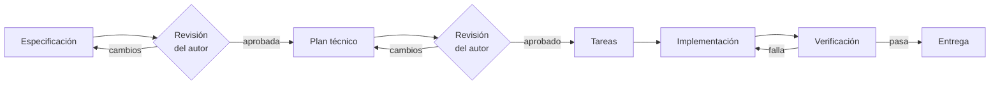

# Metodología de desarrollo con IA

## Introducción

Senda se desarrolla con agentes de inteligencia artificial como herramienta principal de programación. En este proyecto el agente no se usa como autocompletado avanzado. Se le encargan tareas completas: redactar una especificación, proponer un plan técnico, escribir código y sus tests. Esto plantea una pregunta de fondo: **cómo mantener el control sobre un código que no se escribe a mano**, de modo que el resultado responda a lo que el autor quiere y no a lo que el agente supone.

La respuesta adoptada combina tres ideas:

1. **Especificar antes de programar.** Cada funcionalidad se describe por escrito, con criterios de aceptación comprobables, antes de generar una sola línea de código.
2. **Decidir el autor, ejecutar el agente.** Las decisiones de producto y de arquitectura quedan en manos del autor, que revisa y aprueba en puntos concretos del proceso.
3. **Verificar automáticamente.** Tests, linters y comprobaciones de contrato dicen si el código generado es correcto, sin depender de que alguien lo lea línea a línea.

A este conjunto (contexto, reglas, flujo y comprobaciones automáticas en el que trabajan los agentes) lo llamamos **harness**. Se describe a continuación.

## Spec-Driven Development

El proyecto sigue **Spec-Driven Development (SDD)**, un enfoque que se ha extendido en el desarrollo con agentes durante 2025 y 2026. Su premisa es sencilla: cuando quien programa es un modelo de lenguaje, lo que más influye en el resultado es lo bien definido que esté el problema. Una petición vaga produce código plausible pero equivocado; una especificación precisa, con ejemplos concretos de comportamiento esperado, reduce mucho ese margen.

Cada funcionalidad recorre el mismo ciclo:

**Especificación (spec).** Describe qué se quiere y por qué, sin entrar en cómo: el problema que resuelve, el alcance, lo que queda fuera y los criterios de aceptación. El agente redacta un borrador a partir de las decisiones del proyecto y el autor lo corrige.

**Primera revisión.** El autor aprueba la especificación o pide cambios. Es el punto de control más importante: aquí se corrige el malentendido antes de que se convierta en código.

**Plan técnico.** Explica cómo se va a construir: qué partes del sistema cambian, qué contrato de API se expone, qué decisiones técnicas se toman y qué test comprobará cada criterio de aceptación.

**Segunda revisión.** El autor valida el enfoque técnico. Evita que el agente elija por su cuenta una arquitectura o una librería que contradiga decisiones previas.

**Tareas.** El plan se divide en pasos pequeños, cada uno abordable en una sola sesión de trabajo y asociado a los criterios que cubre. Las tareas pequeñas reducen el riesgo de que el agente pierda el hilo en cambios grandes, y dejan constancia de por dónde va el trabajo.

**Implementación y verificación.** El agente implementa tarea a tarea. Una funcionalidad solo se da por terminada cuando cada criterio de aceptación tiene al menos un test que lo comprueba y pasa, y todas las comprobaciones automáticas están en verde.

Las dos revisiones humanas son deliberadas. El coste de corregir un error crece a medida que avanza el ciclo: cambiar una frase de la especificación cuesta segundos; deshacer código ya generado y probado cuesta mucho más.

## Criterios de aceptación en formato Given/When/Then

Los criterios de aceptación se escriben con el formato **Given / When / Then**, procedente de Behaviour-Driven Development (BDD). Cada criterio describe una situación inicial, una acción y un resultado observable. Por ejemplo:

> **Given** un lugar con tres familias que han confirmado que tiene sombra
> **When** un usuario filtra por "sombra"
> **Then** el lugar aparece en los resultados como dato consolidado

Este formato tiene dos ventajas para el trabajo con agentes. Es lo bastante concreto como para que no haya dudas sobre lo que se espera, y se traduce casi directamente en un test automático. Así, la especificación que aprueba el autor y la prueba que verifica el código dicen lo mismo, y la trazabilidad de requisito a test queda explícita: cada criterio lleva un identificador (AC-01, AC-02…) que se cita desde las tareas y desde los propios tests.

## El contexto que recibe el agente

Un agente de IA empieza cada sesión sin recordar las anteriores. Todo lo que necesita saber del proyecto tiene que estar escrito en algún sitio que pueda leer. El diseño de ese contexto sigue dos principios: **una única fuente de verdad** y **cargar solo lo necesario**.

El contexto se organiza en capas:

- **Un fichero de instrucciones general** que el agente carga automáticamente al empezar. Resume qué es el proyecto, cómo se trabaja, qué comandos usar y dónde está cada cosa. Se mantiene breve a propósito, porque se lee en cada sesión y cada palabra cuenta.
- **Una constitución**: ocho reglas no negociables que cualquier agente debe respetar siempre. Por ejemplo, no mezclar en un mismo registro los datos importados de OpenStreetMap con los aportados por las familias, traducir todos los textos a los tres idiomas de la interfaz, o no dar por buena ninguna regla de negocio sin un test que la compruebe.
- **El registro de decisiones del MVP**, que recoge las decisiones de producto y arquitectura tomadas antes de empezar, cada una con un identificador estable que especificaciones y código pueden citar.
- **La especificación activa**, con su plan y sus tareas.
- **Registros de decisiones técnicas (ADR)** para las decisiones que surjan durante el desarrollo.

Cuando dos documentos se contradicen, prevalece el de rango superior en este orden: constitución, registro de decisiones, especificación, ADR. Cada nivel es más concreto y cambia con más frecuencia que el anterior. Y cuando algo no está decidido en ninguno, la instrucción para el agente es preguntar, no decidir.

## Independencia de la herramienta

El proyecto se desarrolla con tres agentes distintos: Claude Code, opencode y Codex. Para no atar la metodología a ninguno, todo el flujo vive en ficheros Markdown dentro del repositorio: las instrucciones, las plantillas de especificación, plan y tareas, y las reglas. No se usan comandos ni configuraciones propias de una herramienta concreta.

Esto tiene una consecuencia práctica: hay un único fichero de instrucciones que leen los tres agentes, en lugar de mantener tres versiones que acabarían divergiendo. También permite comparar cómo se comporta cada agente ante el mismo encargo y con el mismo contexto.

## Verificación automática

La revisión humana se concentra en especificación y plan; la corrección del código la comprueban herramientas automáticas, llamadas **puertas de calidad**:

- **Linters y formateadores** (Ruff en el backend, ESLint en el frontend), que detectan errores comunes y mantienen un estilo uniforme.
- **Comprobación de tipos** con TypeScript en el frontend.
- **Tests unitarios y de integración** (pytest y Vitest) y **tests de flujo** en navegador (Playwright).
- **Validación del contrato de API**: el backend genera automáticamente su especificación OpenAPI, y el cliente del frontend se genera a partir de ella. Un cambio incompatible en la API rompe la compilación del frontend en lugar de fallar en producción.

Estas comprobaciones se ejecutan en dos momentos: antes de cada commit en el equipo del desarrollador, y en integración continua en cada cambio subido al repositorio. Su papel con los agentes es doble: garantizan un mínimo de calidad y dan al agente una señal inmediata y objetiva para corregirse solo, antes de que el autor tenga que intervenir.

## Memoria del proyecto

Como los agentes no recuerdan sesiones anteriores, la continuidad del trabajo depende de lo que queda escrito en el repositorio. Funciona como una memoria compartida por todos los agentes:

- Las instrucciones generales y la constitución explican cómo se trabaja.
- El registro de decisiones y los ADR explican qué se ha decidido y por qué.
- La lista de tareas de cada especificación, con las completadas marcadas, indica dónde se quedó el trabajo, de modo que una sesión nueva puede retomarlo sin explicaciones.

Esta memoria no se actualiza sola: un agente solo escribe en ella cuando el flujo se lo indica. Algunas herramientas tienen además su propia memoria, pero es local y no la comparten los demás agentes, así que nada importante debe depender de ella.

## Idioma

La documentación y los nombres del dominio están en castellano, que es el idioma del proyecto, del producto y de este trabajo. Los términos propios de la metodología se mantienen en inglés (spec, plan, Given/When/Then, acceptance criteria), porque son los que se usan en la literatura y en las herramientas.

Se valoró escribir toda la documentación para los agentes en inglés para reducir el consumo de tokens, ya que el castellano ocupa algo más. Se descartó: la diferencia es pequeña frente al efecto de la longitud de los documentos, y mezclar idiomas entre el dominio y la documentación obligaría al agente a traducir constantemente, con más riesgo de errores. El ahorro real se consigue manteniendo breve el contexto que se carga en cada sesión.

## Registro del uso de la IA

Durante el desarrollo se lleva un registro de cómo se ha usado la IA: qué se pidió en cada sesión, qué hubo que corregir y dónde falló el agente. Tiene dos funciones: aportar evidencia para la evaluación de este trabajo y servir de base para ajustar la metodología con datos reales en lugar de impresiones.

## Validación y evolución

La metodología no se da por buena de antemano. La primera especificación del proyecto es un **esqueleto de extremo a extremo**: un endpoint con lugares de prueba y un mapa que los muestra. Su objetivo no es aportar funcionalidad, sino comprobar que el flujo completo funciona: especificación, revisiones, contrato de API, puertas de calidad y trabajo de los tres agentes.

Tras esa primera iteración se revisará qué partes del proceso sobran o faltan. Dos evoluciones previstas son la incorporación de agentes con papeles diferenciados, empezando por un verificador independiente que compruebe los criterios de aceptación sin haber escrito el código, y un registro compartido de lecciones aprendidas que los agentes consulten y amplíen.
